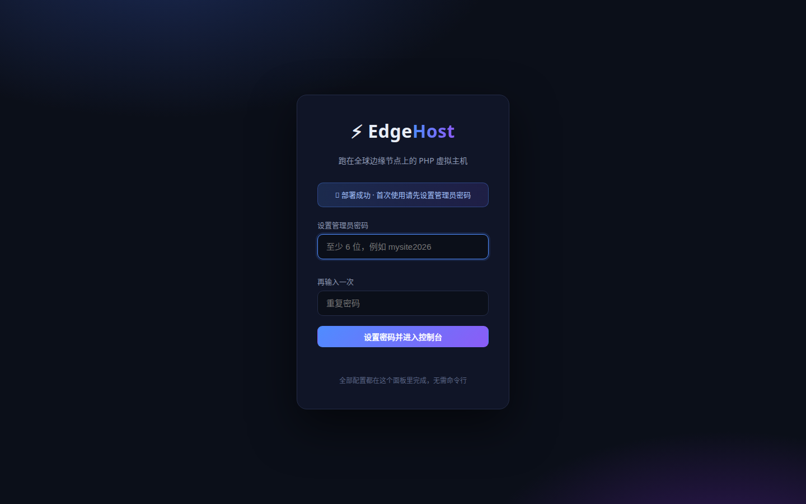
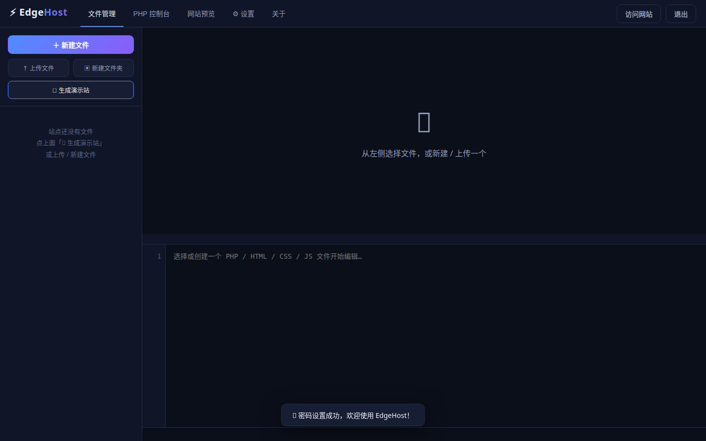
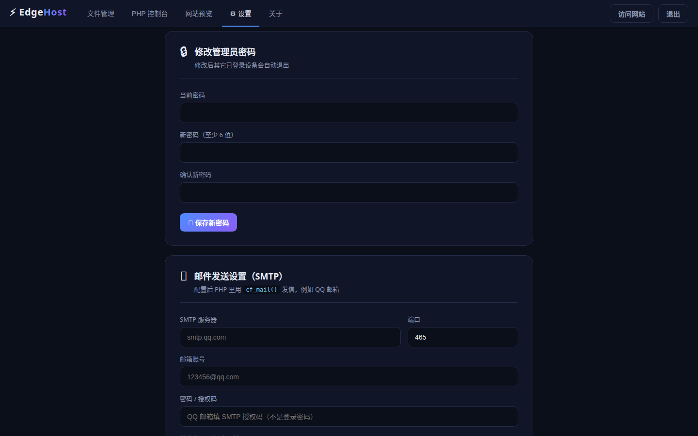
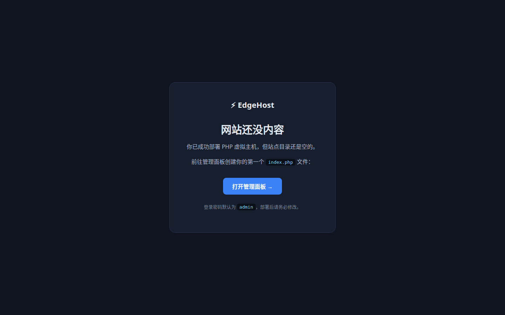

# ⚡ EdgeHost

> 跑在 Cloudflare 全球边缘节点上的 **PHP 虚拟主机** —— 无需 VPS、无需容器、无需数据库、**无需命令行配置**。


EdgeHost 把 PHP 引擎（Zend Engine）编译成 **WebAssembly**，运行在 Cloudflare Workers 的 V8 Isolate 里；站点文件存在 **Durable Objects** 中，通过网页控制台随时上传、编辑、运行。它长得像一台真正的虚拟主机：能跑 `.php`、能放 `.html`、能存图片/音频/视频，**PHP 还能直连外网 API、发邮件**，管理面板独立入口、密码保护。

## 🚀 一键部署（最简单的方式）

> 📖 **新手请看图形化教程：[DEPLOY.md](DEPLOY.md) —— 全程点鼠标、不用敲任何命令**（注册账号 → Fork → 部署 → 设密码 → 绑域名，一步步截图级说明）。

**点下面的按钮就行 —— 不用填用户名、不用填任何 URL。**

> ⚠️ 若提示「无法获取存储库内容 / 无法查询到资源」：说明 Cloudflare 读不到本仓库，请先把项目 **Fork 到你自己的 GitHub 账号**，再从你自己仓库里的按钮部署。详见 [DEPLOY.md](DEPLOY.md)。

[](https://deploy.workers.cloudflare.com/?url=https://github.com/baibianCN/edgehost)

> 点上面按钮 → 用你自己的 GitHub 账号登录 Cloudflare → 一路 Next。Cloudflare 会自动把仓库复制（Clone）到你自己的账号下，你啥都不用填。

⚠️ **一定要从这个按钮进**，不要在 Cloudflare 控制台里手动选「从 Git 仓库导入」再粘 URL —— 手动粘容易出现「无法获取存储库内容」报错（详见文末故障排查）。

部署完成后：

1. 打开 `https://edgehost.<你的账号>.workers.dev/__admin`
2. **第一次进入会在网页里让你设置管理员密码**（不用命令行、不用改配置文件）
3. 点「✨ 生成演示站」，回到网站根路径 `/` 就能看到你的 PHP 网站了
4. 想改密码、配置 QQ 邮箱发信？都在面板的「⚙ 设置」页里点几下搞定

就这么简单。下面「手动部署」章节是给想用命令行的人准备的。

### 📷 界面预览

**首次进入面板 —— 网页直接设置密码，无需命令行：**



**文件管理 —— 在线编辑器 + 上传任意文件：**



**设置页 —— 改密码 / 配 QQ 邮箱发信 / 域名说明，全图形化：**



**访客看到的 PHP 网站：**



```
┌─────────────────────────────────────────────────────┐
│                  Cloudflare Edge                     │
│  ┌──────────────┐   ┌────────────────────────────┐  │
│  │  你的域名     │   │  Worker                   │  │
│  │  example.com │──▶│  ├─ /__admin  管理面板     │  │
│  └──────────────┘   │  ├─ /__api    管理 API     │  │
│                     │  └─ /*        站点 (PHP!)  │  │
│                     │         │                   │  │
│                     │         ▼                   │  │
│                     │  php-wasm (PHP 8.3 WASM)    │  │
│                     └───────────┬────────────────┘  │
│                                 ▼                    │
│                     ┌────────────────────┐          │
│                     │  DO = 虚拟磁盘      │          │
│                     │  /index.php        │          │
│                     │  /assets/logo.png  │          │
│                     │  /music/song.mp3   │          │
│                     │  + 密码 / SMTP 配置 │          │
│                     └────────────────────┘          │
└─────────────────────────────────────────────────────┘
```

---

## ✨ 特性

- **真 PHP**：完整的 PHP 8.3 语法引擎（WASM），函数 / 类 / 数组 / 正则 / 日期 / JSON 全支持
- **外网请求**：`cf_http()` / `http_get()` / `http_post()` / `http_json()` 直连任意 HTTP/HTTPS API，行为和真实虚拟主机一致
- **多文件站点**：`include` / `require` 相对路径可用
- **请求上下文**：`$_GET` `$_POST` `$_COOKIE` `$_SERVER` 自动注入
- **全类型文件**：`.php` `.html` `.css` `.js` `.json` 图片 / 音频 / 视频都能存能跑
- **网页控制台**：文件树管理、在线代码编辑器、**PHP 实时运行控制台**、网站内嵌预览
- **密码保护**：管理员密码通过环境变量设置，登录后签发签名会话 Cookie
- **一键演示站**：面板里点一下生成可运行的 PHP 示例站点（含外网 API 请求演示）
- **零服务器成本**：Cloudflare 免费额度即可跑（Worker 10 万次请求/日 + KV 10 万次读/日）

## 🌐 PHP 请求外网

部署到 Cloudflare 后，PHP 可以直接请求任何外部 API：

```php
// GET 请求
$r = http_get('https://api.ipify.org?format=json');
echo $r['status'];   // 200
echo $r['body'];     // {"ip":"1.2.3.4"}

// POST JSON
$r = http_json('https://api.example.com/user', ['name' => 'Tom']);

// POST 表单
$r = http_post('https://api.example.com/form', 'a=1&b=2',
    ['Content-Type' => 'application/x-www-form-urlencoded']);

// 通用请求（自定义 method / headers / body）
$r = cf_http('https://api.example.com/data', [
    'method'  => 'PUT',
    'headers' => ['X-Token' => 'secret'],
    'body'    => json_encode(['k' => 'v']),
]);
```

> 演示站自带 `/api-demo.php`，部署后打开即可看到 PHP 实时请求外网的效果。

### 发邮件（QQ 邮箱等 SMTP）

**不用敲任何命令**：打开管理面板 →「⚙ 设置」→ 填 SMTP 服务器、邮箱、授权码 → 保存，还能点「发送测试邮件」立即验证。

QQ 邮箱的授权码获取：QQ 邮箱网页版 → 设置 → 账户 → 开启「IMAP/SMTP 服务」→ 生成授权码（16 位，不是登录密码），填进面板密码框即可。

配置好后，PHP 里直接 `cf_mail()` 发信：

```php
cf_mail('friend@example.com', '测试邮件', '你好，这是从 EdgeHost 发出的邮件！');
cf_mail('friend@example.com', 'HTML 邮件', '<h1>Hi</h1>', ['html' => true, 'name' => '我的站点']);
```

## 🚧 已知边界

PHP 运行在 WASM 沙箱里，以下不可用（详见 php-wasm 上游）：

| 不可用 | 说明 |
|---|---|
| `exec` / `proc_open` / 系统调用 | 安全沙箱禁止 |
| `gd` / `imagick` / `intl` / `iconv` | 未编入 |
| MySQL / PostgreSQL 扩展 | 可改用内置 **PDO-CFD1** 接 Cloudflare D1（SQLite） |
| `sleep()` / `usleep()` | 空操作 |
| `header()` 原生输出 | 已提供 `cf_header('Name: value')` 作为替代（见下文） |

> 错误提示（Warning / Fatal error）会**内联显示在页面里**，方便在线调试。

## 🔧 手动部署（命令行方式）

不想用一键按钮？用命令行也就三条命令：

```bash
git clone https://github.com/baibianCN/edgehost.git
cd edgehost
npm install
```

```bash
npx wrangler login      # 登录 Cloudflare（只需一次）
npm run deploy          # 部署
```

搞定。打开 `https://edgehost.<你的账号>.workers.dev/__admin`，第一次进去在网页里设密码就行。

> 本地预览：`npm run dev` → 站点 http://localhost:8787/，面板 http://localhost:8787/__admin。
> 无需创建 KV、无需设置环境变量、无需填任何 id —— 存储和设置全在 Durable Objects 里自动完成。

### 绑定域名

**域名结构**（和真实虚拟主机一致）：

```
https://你的域名/          → 访客看到的网站（你上传的文件）
https://你的域名/info.php  → 你上传的任何页面
https://你的域名/__admin   → 管理面板（你自己用，密码保护）
```

#### 方式 A：免费送的 `workers.dev` 域名（零成本，部署即有）

`npm run deploy` 完成后自动获得 `https://edgehost.<你的账号>.workers.dev`，打开即是你的 PHP 网站。

#### 方式 B：免费域名一条龙（花 0 元，拥有 `xxx.de5.net` 个性域名）

通过 **DNSHE**（dnshe.com）免费申请二级域名并托管到 Cloudflare，全程不花钱：

1. **注册 Cloudflare 账号**：打开 [dash.cloudflare.com](https://dash.cloudflare.com) 注册免费账号（记住账号邮箱）。
2. **注册 DNSHE**：打开 [dnshe.com](https://dnshe.com) 注册账号。
3. **申请免费域名**：在 DNSHE 控制台 → 域名申请 → 选一个后缀（如 `de5.net`）→ 填你想要的二级域名（如 `mysite.de5.net`）→ 提交申请，一般几分钟内审核通过。
4. **把域名的 NS 托管到 Cloudflare**：
   - 回到 Cloudflare Dashboard → **Add a site** → 输入 `mysite.de5.net` → 选 **Free 套餐**；
   - Cloudflare 会分配 2 个 NS 地址（形如 `xxx.ns.cloudflare.com`）；
   - 把这两个 NS 地址填到 DNSHE 的域名管理页（NS/DNS 设置处）保存。
5. **等 NS 生效**（通常几分钟到几小时），Cloudflare 里站点状态变成 **Active**。
6. **绑定到 Worker**：

```bash
npx wrangler domains add mysite.de5.net
```

或在 Cloudflare Dashboard → Workers & Pages → edgehost → Settings → Domains → Add Custom Domain，输入 `mysite.de5.net`，秒级生效。

之后访问 `https://mysite.de5.net` 就是你的 PHP 网站，`https://mysite.de5.net/__admin` 是管理面板。

#### 方式 C：自己的付费域名

```bash
npx wrangler domains add example.com
# 域名 NS 托管在 Cloudflare 时秒级生效；否则在域名后台加 CNAME → edgehost.<账号>.workers.dev
```

## 🎮 使用面板

| 入口 | 说明 |
|---|---|
| `/` | 你的站点（访客看到的就是这里） |
| `/__admin` | 管理面板（需密码） |

面板功能：

1. **文件管理** — 左侧文件树，点击即可编辑；支持新建 PHP/HTML/CSS/JS、上传图片/音频/视频/任意文件、删除
2. **PHP 控制台** — 实时执行 PHP 片段，调试代码（含外网请求、发邮件）
3. **网站预览** — 面板内 iframe 直接预览站点，或一键新窗口打开
4. **⚙ 设置** — 图形化修改管理员密码、配置 QQ 邮箱 SMTP（带一键测试邮件）、查看域名
5. **✨ 生成演示站** — 站点为空时一键生成可运行的 PHP 示例（含外网 API 演示页）

> 首次访问 `/__admin` 时，面板会自动进入「设置管理员密码」界面——不用碰命令行，设完密码即可使用。

媒体文件上传后，可以直接在 PHP/HTML 里引用：

```php

<audio controls src="/music/song.mp3"></audio>
```

### 设置响应头（替代 header()）

```php
cf_header('Content-Type: application/json; charset=utf-8');
cf_header('X-Custom: value');
echo json_encode(['ok' => true]);
```

## ⚙️ 配置

**全部配置都在网页面板里完成，不需要改文件、不需要命令行。**

| 配置项 | 位置 | 说明 |
|---|---|---|
| 管理员密码 | 面板「⚙ 设置」 | 首次进入面板时设置，之后可随时修改 |
| SMTP 邮箱 | 面板「⚙ 设置」 | QQ 邮箱等，填服务器/账号/授权码，带测试按钮 |
| 站点文件 | 面板「文件管理」 | 上传 / 新建 / 编辑 / 删除，存在 Durable Objects |
| `compatibility_date` | `wrangler.toml` | 必须 ≥ `2025-05-05`（Vrzno 依赖 WeakRef），已配好无需改 |

## 🔌 API 参考

管理 API 均在 `/__api` 下，除 `setup` / `login` 外都需要登录 Cookie。

| 方法 | 路径 | 说明 |
|---|---|---|
| POST | `/__api/setup` | 首次设置密码 `{password}`（仅密码未设时可用） |
| POST | `/__api/login` | `{password}` → 设置会话 |
| POST | `/__api/logout` | 退出登录 |
| GET | `/__api/me` | 当前状态 / 是否需要初始化密码 |
| GET | `/__api/tree` | 文件树 |
| GET | `/__api/files` | 全部文件（含内容） |
| GET | `/__api/file?path=` | 读取单个文件 |
| PUT | `/__api/file?path=` | 写入 `{content, binary?, mime?}` |
| DELETE | `/__api/file?path=` | 删除文件 |
| POST | `/__api/upload` | 批量上传 `{files:[{path,content(base64),binary,mime}]}` |
| POST | `/__api/init` | 生成演示站（站点为空时） |
| POST | `/__api/run` | PHP 控制台 `{code, path?}` |
| POST | `/__api/password` | 修改密码 `{current, next}` |
| GET | `/__api/settings` | 读取 SMTP 设置（密码掩码） |
| PUT | `/__api/settings` | 保存 SMTP 设置 `{smtp:{host,port,user,pass,from}}` |

站点侧：`/任意路径` 解析站点文件；`.php` 动态执行，其余静态返回；目录自动找 `index.php` / `index.html`；`?raw=1` 返回原始文件（下载 / 媒体引用）。

## 🗂 目录结构

```
edgehost/
├── wrangler.toml        # 部署配置（DO 绑定、兼容日期，零配置）
├── package.json
├── worker/              # Worker 源码
│   ├── index.js         #   路由：面板 / API / 站点
│   ├── php-engine.js    #   php-wasm 引擎 + 外网桥 + SMTP 发信
│   ├── api.js           #   管理 API + 演示站
│   ├── store.js         #   Durable Object 虚拟文件系统 + 设置存储
│   ├── auth.js          #   HMAC 会话鉴权
│   ├── panel.js         #   管理面板（由 build-panel 生成）
│   └── utils.js
├── panel/               # 管理面板源码（修改后需重新打包）
│   ├── index.html
│   ├── style.css
│   └── app.js
└── scripts/
    └── build-panel.mjs  # 把 panel/ 打包成 worker/panel.js
```

> 改了 `panel/` 里的文件后，运行 `npm run build:panel` 重新打包。

## 🛠 故障排查

| 问题 | 解决 |
|---|---|
| **「无法获取存储库内容」/ Unable to fetch repository contents** | Cloudflare 只允许部署**你自己的 GitHub 账号下的仓库**。① 别手动粘 URL，回到 README 点那个「Deploy to Cloudflare」按钮进入；② 确认 Cloudflare 里「Connect to GitHub」授权的是**拥有该仓库的账号**（例：仓库在 `baibianCN` 名下，就必须用 `baibianCN` 授权）；③ 若你想用别的账号，先去 GitHub 点 **Fork** 把仓库复制到自己名下，再从按钮部署、URL 填你 Fork 后的地址 |
| `Internal Error 500` / `out of memory` | PHP WASM 初始内存 64MB，页面逻辑别太重的循环；并发高时升级 Worker 套餐 |
| 部署报 wasm 相关错误 | `compatibility_date` 设成 `2025-05-05` 或更新（已配好） |
| 忘记管理密码 | 删掉 Cloudflare Dashboard 里该 Worker 的 Durable Object 存储（或本地删 `.wrangler/state`），重新访问面板即可重设 |
| 面板提示未登录 | 改密码后其它设备会自动下线，用新密码重新登录即可 |
| 发邮件失败 | 在面板「⚙ 设置」确认 SMTP 服务器/账号/授权码正确，QQ 邮箱要用授权码不是登录密码；点「发送测试邮件」验证 |
| 外网请求失败 | 确认部署在 Cloudflare（不是受限本地沙箱），PHP 用 `http_get/http_post/http_json` |

## 📦 技术栈

- [php-cloud-wasm](https://github.com/seanmorris/php-wasm) — Zend Engine → WebAssembly（PHP 8.0–8.5）
- [Cloudflare Workers](https://workers.cloudflare.com/) — V8 Isolate 边缘运行时
- [Cloudflare Durable Objects](https://developers.cloudflare.com/durable-objects/) — 单实例强一致存储（文件 + 设置，零配置）

## 📄 License

MIT
